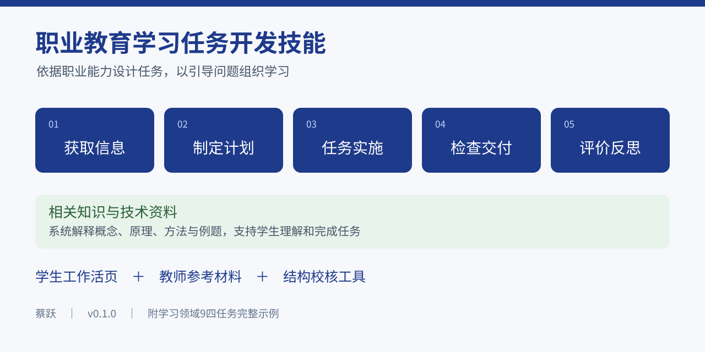

# 职业教育学习任务开发技能

**从课程职业能力要求出发，开发有引导问题、有实际活动、有成果记录、有系统理论知识的学习任务。**

作者：蔡跃｜版本：v0.1.0｜整理日期：2026-11-03

> 发布进度：技能源码与说明文件已经公开，可以通过仓库的 Code 菜单下载源码ZIP，并取出 skills/develop-vocational-learning-tasks 文件夹使用。独立技能安装包和两份Word示例尚待完成附件上传，正式下载版仍为草稿。

[技能源码](skills/develop-vocational-learning-tasks/SKILL.md) · [使用说明](docs/usage.md) · [环境说明](docs/environment.md) · [完整示例](examples/lf09-comfort-safety/README.md) · [许可](LICENSE) · [引用方式](docs/citation.md)



## 项目用途

本项目为职业院校专业课教师、课程建设团队和教材编写团队提供可复用的 AI 技能规则、参考方法、模板及结构校核工具，协助开发学生工作活页和教师参考材料。

支持中职、高职专科、职业本科等教学情境；实际采用的任务难度、理论深度和技术资料须依据课程及学生基础调整。本版本的公开示例来自汽车技术领域，其他专业的应用仍需相应专业资料和审查。

## 可以完成的工作

- 从课程或任务名称及基本条件起步，设计学习情境、目标和成果要求。
- 依据课程标准、企业工作材料或已有教材重构学习任务。
- 通过引导问题组织信息获取、方案计划、实际实施和检查交付。
- 参考修订版布鲁姆认知过程分类，逐步提高问题的思考要求。
- 系统撰写与任务相关的概念、原理、方法、例题和技术资料。
- 编制学生工作活页、教师参考稿，并审查目标、活动、知识和评价的对应关系。

## 十部分结构

| 序号 | 部分 | 编写重点 |
|---|---|---|
| 1 | 学习情境 | 角色、工作对象、真实需求与约束 |
| 2 | 学习目标 | 可观察、可评价的职业能力要求 |
| 3 | 任务要求 | 输入、成果、质量、期限和提交方式 |
| 4 | 任务分工 | 个人职责、协作与个人成果 |
| 5 | 获取信息 | 通过问题阅读资料、理解原理、分析条件 |
| 6 | 制定计划 | 通过问题比较方案、作出选择并编制计划 |
| 7 | 任务实施 | 通过问题组织实际操作、计算、设计和记录 |
| 8 | 检查交付 | 通过问题组织检验、判定、整改及交付 |
| 9 | 评价反思 | 依据证据评价表现，分析改进与迁移 |
| 10 | 相关知识与技术资料 | 完整撰写必要理论，提供相关技术资料 |

四个中间环节以引导问题组织主要学习内容。认知要求参考记忆、理解、应用、分析、评价和创造，按工作逻辑递进，不要求每个环节机械凑齐六层。

相关知识与技术资料是完整教材正文，须解释概念、原理、方法及适用条件。普通任务可预留约4—8页A4理论正文，复杂任务可更多，具体以知识完整性和用户要求为准。

## 快速开始

1. 通过仓库 Code 菜单选择 Download ZIP，解压并找到 `skills/develop-vocational-learning-tasks` 文件夹；独立技能ZIP上传后将另行提供下载。
2. 在支持技能导入的 AI 客户端中导入该包，或按客户端要求放置完整技能文件夹。具体入口和路径以所用客户端为准。
3. 说明专业、培养层次、课程、任务、学时、学生基础、设备和资料条件。
4. 提交开发要求，先检查任务条件与目标，再检查学生稿和教师参考稿。

示例调用：

```text
请使用 $develop-vocational-learning-tasks，为高职汽车检测与维修技术专业开发一个学习任务。
课程：汽车舒适与安全系统检修。
任务：座椅占用识别间歇故障定位。
建议8学时，学生已学习基本电路和万用表使用。
仅使用教师批准的隔离模拟线束，所需参数以我提供的资料为准。
请按十部分结构编写学生工作活页，四个中间环节通过引导问题组织，最后系统撰写理论知识。
另附教师参考稿。资料缺口、教学模拟数据和需课前确认的条件应明确说明。
```

只有课程或任务名称时也可起步，输出需要标注合理假设。没有核实的技术条件不能被当作已经证实的操作依据。

## 完整示例

[学习领域9 舒适与安全系统服务](examples/lf09-comfort-safety/README.md)的学生工作活页和教师参考两份Word已经整理，附件上传尚未完成；当前先提供复现输入与成果导读。示例覆盖四个任务，建议合计60学时：

| 任务 | 建议学时 |
|---|---:|
| 事故后乘员保护系统检查与修复方案 | 16 |
| 座椅占用识别间歇故障定位 | 8 |
| 空调制冷性能诊断与维护交付 | 24 |
| 门锁与车窗联动失效的共因诊断 | 12 |

示例展示资料改编、引导问题、操作记录、系统理论及教师评价材料的配合方式。它是作者提供的优化再设计成果，不作为无需人工修改即可一次生成同等结果的保证。输入说明为依据现有成果整理的复现模板，未冒充原始运行日志。

## 输出与人工审查

默认输出学生工作活页和教师参考稿。Word格式与分页检查需要相应文档工具及字体；精确图样需要可靠原始资料或可核查的绘图工具。AI生成内容仍需教师核查技术依据、任务可实施性、理论准确性和评价标准。

内置 `check_design.py` 可检查开发记录结构、问题编号、目标与知识对应、来源状态和评分总和。它不能自动判定理论正确性或教学效果。

## 目录与运行条件

| 位置 | 内容 |
|---|---|
| `skills/develop-vocational-learning-tasks/` | 可安装技能源文件 |
| `docs/` | 使用、环境、引用、许可及发布说明 |
| `examples/lf09-comfort-safety/` | 完整示例、复现输入和成果导读 |
| 独立技能ZIP | 已整理，待完成附件上传 |
| `scripts/validate_release.py` | 发布材料及文件完整性检查 |

本项目没有独立的聊天网页或服务端，不要求项目自身的API密钥。内容生成由所选AI环境完成。已做的检查与尚未验证的环境见[环境说明](docs/environment.md)。

## 作者与方法来源

作者：蔡跃，同济大学职业技术教育学院。

开发方法依据蔡跃《职业教育活页式教材开发指导手册》的开发论述及六个案例归纳，结合职业能力、工作过程和引导问题设计要求。六案例方法摘要见技能参考文件；原书全文不随项目发布。认知分类依据和其他引用见[引用说明](docs/citation.md)。

## 许可与第三方资料

本版本采用保留著作权的公开下载与教学研究使用说明，允许下载并在本人教学研究中本地使用；再次发布、商业分发及其他超出本许可的使用需取得相应许可。本版本未采用MIT等标准开源许可证，不能据此宣称全部材料均已开放任意再利用。

示例中的第三方图文、品牌和技术资料不包含在作者可授予的许可范围内，仍归原权利人所有；公开可见不代表取得它们的复制、改编或再分发许可。德文原书PDF不在仓库内提供。具体见[许可文件](LICENSE)和[第三方资料说明](docs/third-party-notices.md)。

## 反馈

欢迎通过仓库Issues反馈任务类型、输入条件、预期行为与实际差异。提交前删除学生、客户和企业的非公开信息。项目不承诺对所有专业、软件平台或真实维修条件提供一致结果。
